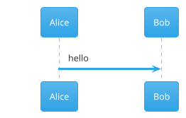

# Figvex

[](https://app.netlify.com/projects/figvex/deploys)

**Live site: [figvex.sudo520.com](https://figvex.sudo520.com)**

A live editor for PlantUML, Mermaid, Graphviz and BPMN diagrams, network diagrams, org charts, data charts and freeform sketches. Type on the left, the diagram redraws on the right. It runs in the browser, and your diagrams stay on your machine unless you share them or turn on the PlantUML server option.

It was built for computer science students: UML for software engineering courses, ER diagrams for databases, state machines and automata for theory, trees and graphs for algorithms, Gantt charts for group projects, and charts of results for lab reports.


## Features

- Live preview for PlantUML, Mermaid, Graphviz DOT, BPMN 2.0 and ECharts data charts, with the language picked up from the first line
- Network diagrams with device icons, subnets, VLANs, ports and link types, and checks that catch address mistakes as you type
- Org charts from an indented list of people, with departments, assistants, vacancies, dotted lines and three card styles
- A sketch canvas for freeform diagrams: boxes, arrows that stay attached, text and pen, in a clean or hand-drawn style
- 68 templates written around coursework: a library system class diagram, JWT login sequence, TCP state machine, DFA for multiples of 3, binary search tree, hash table, confusion matrix, sorting benchmark, library loan process, login wireframe, society committee org chart, subnetting exercise, university ER schema, capstone Gantt plan and more
- Export to SVG, PNG, JPG, WEBP and vector PDF, at 1× to 4× scale, with a solid or transparent background
- Copy the image straight to the clipboard for pasting into a report or slides
- Share links that carry the whole diagram in the URL, with no server involved
- Copy as a Markdown code block, or as a plantuml.com image link for a README
- Plain black-and-white PlantUML by default, with PlantUML's own colours and its 40 bundled themes one click away
- Click a shape in the diagram to jump to the line that drew it
- Errors point at the line, with a marker in the editor
- Every diagram saved in the browser, with rename, duplicate, delete and undo; collapsed, the list stays as a narrow rail of recent diagrams
- A language picker above the editor that you can type into to search; changing the language of a diagram with real content starts a new one, so nothing is overwritten
- Open `.puml`, `.mmd`, `.gv`, `.dot`, `.bpmn`, `.sketch`, `.org`, `.network`, chart and Markdown files, or drag them onto the window; a `.csv` file opens as a bar chart of its columns
- Light and dark themes for the app and for the diagrams, separately
- Pan and zoom with mouse, trackpad or touch; works on phones as two tabs

## How it works

PlantUML runs through [`@plantuml/core`](https://www.npmjs.com/package/@plantuml/core), the official build of PlantUML compiled to JavaScript with TeaVM. It is built from the same source as the Java release and carries the same version number. Graphviz layouts come from Viz.js. It needs neither Java nor a server.

Mermaid runs through the [`mermaid`](https://www.npmjs.com/package/mermaid) package and is only downloaded the first time you open a Mermaid diagram.

Graphviz DOT uses the same Viz.js file that PlantUML loads, so it adds nothing to the download. A DOT diagram on its own loads only that file, not the rest of PlantUML.

Charts use [Apache ECharts](https://echarts.apache.org/), downloaded the first time you open one (about 280 KB compressed). Only the chart types listed below are bundled.

The app itself is TypeScript, Vite and CodeMirror 6, with no UI framework.

### What reaches the network

- The page and its scripts, from wherever you host it.
- PlantUML standard library bundles (C4, AWS icons and so on) when a diagram uses `!include <...>`. Bundles with a permissive licence (C4, ArchiMate, DomainStory) are served from your own site. The rest come from `plantuml.github.io` unless you change `VITE_PLANTUML_STDLIB_URL`; see [LICENSES.md](LICENSES.md#plantuml-standard-library).
- Nothing else, unless you turn on the PlantUML server option (below) or copy a plantuml.com image link.

## Supported diagrams

| PlantUML | Mermaid | Graphviz |
| --- | --- | --- |
| Sequence, use case, class, object, activity, component, deployment, state, timing | Flowchart, sequence, class, state, ER, user journey | Directed and undirected graphs, written in DOT |
| ER (crow's foot), JSON, YAML | Gantt, pie, quadrant, XY chart, Sankey | Trees, automata, dependency graphs, record-based data structures |
| Gantt, mind map, work breakdown | Git graph, mind map, timeline, Kanban | All Graphviz layouts: `dot`, `neato`, `fdp`, `sfdp`, `circo`, `twopi`, `osage`, `patchwork` |
| Regex, EBNF, ArchiMate, C4 and the rest of the standard library | Packet, block, architecture, C4, requirement, radar, treemap and the newer types in Mermaid 12 | |

PlantUML's `@startdot` blocks are drawn with Graphviz too.

The browser build of PlantUML doesn't include these yet: Salt wireframes, ditaa, math and LaTeX, nwdiag, Chen ER, `@startfiles`, `@startchronology`, `@startboard`, `@startgit`, `@startwire`, `@starthcl`, and `!include` from a URL.

When a diagram uses one of these, Figvex says so instead of showing a stack trace. In Settings you can turn on **Use server for missing types**. Only those diagrams are then sent to a PlantUML server to be drawn. The default is plantuml.com; you can point it at your own server (see Docker below).

## BPMN

Business process diagrams in BPMN 2.0 are drawn by Figvex's own renderer, written from the OMG specification. There's no bpmn.io watermark, because bpmn-js isn't used.

- Files from Camunda Modeler, bpmn.io, Signavio and other tools open as they are, drawn with the positions saved in the file.
- Files with no saved positions are laid out automatically: left to right, with pools and lanes as horizontal bands. A short process can be written by hand:

```xml
<definitions xmlns="http://www.omg.org/spec/BPMN/20100524/MODEL">
  <process id="p">
    <startEvent id="start" name="Order received" />
    <userTask id="pack" name="Pack order" />
    <endEvent id="end" name="Shipped" />
    <sequenceFlow id="f1" sourceRef="start" targetRef="pack" />
    <sequenceFlow id="f2" sourceRef="pack" targetRef="end" />
  </process>
</definitions>
```

Supported: start, end, intermediate and boundary events with message, timer, error, signal, escalation, conditional, link, compensation, cancel and terminate markers; tasks of every type; sub-processes, transactions and call activities; loop and multi-instance markers; all five gateway types; data objects and data stores; pools, lanes, message flows, text annotations and groups. Colours set with bpmn.io's `bioc:` or the OMG `color:` attributes are kept. Typing `<` in the editor lists the BPMN elements.

## Sketches

For diagrams that don't fit a language: draw them. Pick **Blank sketch** under Templates, then use the tools above the diagram.

| Tool | Key | |
| --- | --- | --- |
| Select | V | Click to select, Shift-click to add, drag on empty space to box-select, drag to move, drag a corner to resize |
| Box, Ellipse, Diamond | R, O, D | Drag to draw, or click for the usual size |
| Arrow, Line | A, L | Start or end on a shape to attach to it; attached lines follow when it moves |
| Connector | C | An arrow with right angles, for org charts and flow diagrams |
| Text | T | Click and type |
| Pen | P | Freehand |

Double-click a shape or arrow (or press Enter) to edit its label; double-click empty space to add text. Delete removes the selection, Ctrl/⌘ D duplicates it, arrow keys nudge it, and Ctrl/⌘ Z undoes. Shapes snap to a 10 px grid; hold Alt to place freely. Scroll, or hold Space and drag, to pan.

Snapping and arranging:

- While moving, resizing or drawing, a shape lines up with the edges and centres of the shapes around it, and a guide line shows what it lined up with.
- While drawing or re-attaching a line, the shape under the pointer shows a connection point on each side. Drop on one to pin the line to that side (`ceo.bottom`); drop anywhere else on the shape and the side follows the shape's position.
- E switches the selected lines between straight and right angles.
- With two or more shapes selected, buttons appear to align their left edges, centres, right edges, tops, middles or bottoms; with three or more, to space them evenly across or down.

A sketch is stored as text, one element per line, so it saves, shares and undoes like everything else, and you can edit it on either side:

```
sketch
box login 40 40 160 80 "Login page" round fill=#fde68a
ellipse user 260 60 120 60 "User"
arrow user -> login "signs in" dashed
line login.right -> user.left elbow dashed
text note 40 160 "Notes go here" size=18
```

Elements are `box`, `ellipse`, `diamond`, `text`, `arrow`, `line` and `pen`. Options are `fill=`, `stroke=`, `width=`, `size=`, `dashed`, `round` and `bold`; arrows and lines also take `both` or `none` for their heads and `elbow` for right angles, and either end can name a side, such as `ceo.bottom`. The Style menu switches between **Clean** and **Hand-drawn**.

## Org charts

Write the people as an indented list and Figvex lays out the chart. Indenting a line puts that person under the line above.

```
orgchart
title "Northwind Software"
counts
Jane Smith: Chief Executive [Executive]
  + Lee Park: Executive Assistant
  Ravi Patel: Chief Technology Officer [Engineering]
    Ana Lopez #ana: Engineering Manager
      Tom Reed: Developer
      ?: Graduate Developer
  Mia Chen #mia: Chief Financial Officer [Finance]
ana .. mia "budget"
```

| Write | For |
| --- | --- |
| `Name: Job title [Department]` | A person. Only the name is needed. People without a department take their manager's colour. |
| `+ Name: Job title` | An assistant, shown beside the manager rather than below |
| `?: Job title` | A vacant post, drawn dashed |
| `Name #id` | A short name, for dotted lines or when two people share a name |
| `a .. b "label"` | A dotted-line (matrix) reporting line |
| `title "…"` | A heading above the chart |
| `direction right` | Left to right instead of top down |
| `compact` | Stack the bottom level of each branch in a column, for wide teams |
| `counts` | Show how many people sit under each manager |

The Style menu has **Cards** (initials and a department colour strip), **Minimal** (black and white, for printing) and **Bold** (department-coloured headers). Department colours come with a legend, and clicking a person jumps to their line. For a chart you want to arrange by hand instead, use a sketch with the Connector tool.

## Networks

Write devices, zones and links, and Figvex lays out the network with device icons. Indenting devices under a `zone` line puts them in it. A zone can be a subnet, a VLAN or a whole site, and zones can sit inside each other.

```
network
title "Small office"
internet
firewall fw "Firewall" 203.0.113.2/30
zone dmz "DMZ" 172.16.0.0/24 vlan 30
  server web "Web server" 172.16.0.10
zone office "Office" 10.10.0.0/16
  switch core "Core switch" 10.10.0.2
  zone staff "Staff" 10.10.10.0/24 vlan 10
    pc desks "Desk PCs" x12
    printer prn "Printer" 10.10.10.5
internet -- fw "WAN"
fw:eth1 -- web
fw:eth2 == core:ge0/1 "trunk" vlan 10, 20
core -- desks, prn
```

| Write | For |
| --- | --- |
| `type name "Label" addresses` | A device. Types: `internet`, `cloud`, `router`, `firewall`, `switch`, `lb`, `ap`, `server`, `vm`, `database`, `storage`, `pc`, `laptop`, `phone`, `printer`, `camera`, `iot`, `user` |
| `"Note"`, `vlan 20`, `x12` | After a device: a second line of text, its access VLAN, or a count drawn as a stack |
| `zone name "Label" 10.0.0.0/24 vlan 10` | A zone. The subnet and VLAN are optional; a zone with neither is drawn dashed, as a site |
| `a -- b` | A cable. `==` is a trunk or fibre link, `..` a VPN or tunnel, `~~` wireless |
| `a -- b, c, d` | Several links from one device |
| `a:ge0/1 -- b:eth0` | Port names at either end |
| `"label" vlan 10, 20` | After a link: a label and the VLANs it carries |
| `title "…"` | A heading above the diagram |
| `direction right` | Left to right instead of top down |
| `lines curved` | `straight` (default), `curved` around devices, or `square` for right-angled lines |
| `checks off` | Turn off the address checks |
| `# comment` | A comment |

Addresses can be IPv4 or IPv6, with or without a prefix. Figvex checks them as you type and marks anything that looks wrong in the editor margin, on the device and in the status bar. Clicking the warning count goes to the first one. It checks for:

- an address outside its zone's subnet
- the same address on two devices
- a subnet's network or broadcast address used by a device
- a zone subnet with host bits set, such as `10.0.0.5/24`
- zone subnets that overlap, or a zone's subnet outside the zone around it
- the same VLAN on two zones at one site, or a device on a different VLAN from its zone
- devices that aren't linked to anything

The checks don't stop the drawing. The Style menu has **Colour tiles**, **Outline** and **Greyscale**. Clicking a device, link or zone jumps to its line.

## Charts

A chart is an [ECharts option](https://echarts.apache.org/en/option.html) written as JSON. Comments and trailing commas are allowed. Data can go in the JSON, or as CSV under a line of three dashes, where it becomes the chart's dataset:

```
{
  "title": { "text": "Students per language" },
  "xAxis": { "type": "category" },
  "yAxis": {},
  "series": [{ "type": "bar" }]
}
---
language,students
Python,120
Java,85
C,40
```

Each column after the first becomes a series, in order. `"width"` and `"height"` at the top level set the size in pixels (720 × 440 by default).

Chart types: bar, line, pie, scatter, radar, box plot, heatmap, candlestick, funnel, gauge, Sankey, graph, tree, treemap, sunburst, parallel coordinates and theme river. JSON can't hold functions, so options that need a JavaScript callback, such as a custom tooltip formatter, aren't available; string templates like `"{b}: {c}"` work.

## Styles

PlantUML diagrams are drawn with the `plain` theme by default: black lines, white boxes, no fills. That suits printed reports.

The **Style** menu above the editor switches to PlantUML's classic colours or any of its bundled themes. The style is applied while drawing and doesn't change your source. To keep a look when the file is used elsewhere, put the theme in the diagram:



A `!theme` line in the diagram always wins over the menu. Mermaid has the same menu, with its own themes.

For Graphviz the menu has two choices. **Plain** draws labels in a sans-serif font, and **Graphviz defaults** keeps Times, as the `dot` command does. Colours, fonts and shapes set in the DOT source always win.

For charts it sets the colour palette: ECharts' **Default**, **Colour-blind safe** (Okabe and Ito's palette) or **Greyscale** for black-and-white printing. A `"color"` list in the chart wins.

## Run it locally

Needs Node 20 or later.

```sh
npm install
npm run dev
```

Then open http://localhost:5173.

`npm install` copies the PlantUML engine from `node_modules` into `public/vendor/`. If that folder is ever missing, run `node scripts/copy-plantuml.mjs`.

### Tests

```sh
npm test            # unit tests (Vitest)
npm run build
npm run test:e2e    # browser tests against the production build
```

The browser tests drive Chrome with puppeteer-core. They render every template, check error reporting, click-to-source and the SVG, PNG and PDF exports. They look for Chrome in the usual places; set `CHROME_PATH` if yours is elsewhere. Without Chrome they're skipped.

## Deploy to Netlify

Releases go `dev` to `staging` to `main`. `staging` is deployed as a Netlify branch deploy for testing; `main` is the live site. See [CONTRIBUTING.md](CONTRIBUTING.md#branches-and-releases) for the commands.

1. Push the repository to GitHub, GitLab or Bitbucket.
2. In Netlify, choose **Add new project → Import an existing project** and pick the repository.
3. Leave the build settings alone. `netlify.toml` sets the build command (`npm run build`), the publish folder (`dist`), Node 22 and the cache headers.
4. Under **Project configuration → Developer settings → Continuous deployment → Branches and deploy contexts**, set the production branch to `main`, and under branch deploys choose **Let me add individual branches** and add `staging`.

The build downloads the permissively licensed PlantUML stdlib bundles from `plantuml.github.io` so the site can serve them itself. If that download fails, the build still succeeds and those bundles are fetched from `plantuml.github.io` at runtime instead.

On the free plan, each production deploy costs 15 credits out of a 300-credit limit, so deploy releases rather than every commit. Netlify's Open Source plan raises the limit; see [Hosting costs](ROADMAP.md#hosting-costs-on-netlify) in the roadmap.

Any static host works the same way: run `npm run build` and serve `dist/`.

## Docker

```sh
docker compose up -d
```

Figvex is then on http://localhost:8080. The image is a two-stage build: Node builds the site, nginx serves it.

To keep everything on your own machines, including the diagram types the browser engine lacks, run a PlantUML server next to it:

```sh
VITE_PLANTUML_SERVER=http://localhost:8081 docker compose --profile server up -d --build
```

The server address is baked in at build time, so it has to be reachable from your users' browsers, not only from the container.

Without Compose:

```sh
docker build -t figvex .
docker run -p 8080:8080 figvex
```

## Configuration

Set these as environment variables when building (in Netlify under **Site configuration → Environment variables**, or as Docker build arguments).

| Variable | Default | Purpose |
| --- | --- | --- |
| `VITE_REPO_URL` | `https://github.com/ahmed-imraan-ai/figvex` | GitHub links in the header, the help menu and the About box. Set it to an empty string to hide them |
| `VITE_SITE_URL` | Netlify's `URL`, else `https://figvex.netlify.app` | Public address used for the canonical link, social preview cards, `robots.txt` and `sitemap.xml` |
| `VITE_PLANTUML_SERVER` | `https://www.plantuml.com/plantuml` | Server for diagram types the browser engine lacks, and for copied image links |
| `VITE_PLANTUML_STDLIB_URL` | `https://plantuml.github.io/plantuml/js-plantuml/` | Where stdlib bundles not shipped with the site come from |
| `PLANTUML_STDLIB_SOURCE` | same as above | Where `scripts/fetch-stdlib.mjs` downloads bundles from during the build |

## Project layout

```
src/
  main.ts             wiring: documents, rendering, toolbar, shortcuts
  engines/            PlantUML, Mermaid, Graphviz, ECharts, BPMN, sketch, org chart and network engines, language detection, themes
  editor/             CodeMirror setup, syntax colouring, autocomplete
  preview.ts          pan and zoom canvas, click-to-source
  export.ts           SVG, PNG, JPG, WEBP and PDF export
  share.ts            share links
  store.ts            diagrams and settings in localStorage
  templates/          the template gallery
  ui/                 popovers, dialogs, library drawer
scripts/              engine copy and stdlib download, run at install and build
tests/unit/           Vitest unit tests
tests/e2e/            browser tests
docker/               nginx config for the Docker image
```

## Keyboard shortcuts

| Keys | Action |
| --- | --- |
| Ctrl/⌘ K | Templates |
| Ctrl/⌘ B | Expand or collapse your diagrams |
| Ctrl/⌘ O | Open a file |
| Ctrl/⌘ S | Download the source file |
| Ctrl/⌘ Shift E | Export image |
| Ctrl/⌘ Enter | Redraw now |
| Ctrl/⌘ / | Comment or uncomment lines |
| 0 and 1 on the diagram | Fit to view, actual size |
| ? or F1 | Help |

## Roadmap

The full plan is in [ROADMAP.md](ROADMAP.md). It has three phases:

1. Complex networking and visual editing.
2. Statistical charts, UI wireframes, network diagrams, advanced UML, cloud infrastructure, complex data models and coursework tools such as truth tables, Karnaugh maps and automata.
3. Advanced scientific and financial charts, geographic maps, CAD, 3D, electrical schematics, formal process models and interactive visual analytics.

AI assistance is planned alongside these, through MCP only: people use their own assistant and subscription, such as Claude Code or Claude Desktop, and it works with Figvex through a local `figvex-mcp` server. There's no login; links and pairing codes connect the assistant to the user's diagrams. Figvex runs no AI service of its own.

Ideas and pull requests are welcome. See [CONTRIBUTING.md](CONTRIBUTING.md) and the [Code of Conduct](CODE_OF_CONDUCT.md).

## AI use

AI was used in this project.

## Licence

Figvex is MIT licensed. See [LICENSE](LICENSE).

[LICENSES.md](LICENSES.md) covers everything Figvex ships or loads: the licence of each component, how the PlantUML standard library is handled, which services are contacted, and why the project uses MIT rather than GPL. Each build also writes `third-party-licenses.txt` with the full licence text of all 158 bundled packages; the deployed site links to it from the Help dialog.
