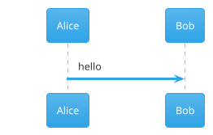

# Figvex

[](https://app.netlify.com/projects/figvex/deploys)

**Live site: [figvex.sudo520.com](https://figvex.sudo520.com)**

A live editor for PlantUML and Mermaid diagrams. Type on the left, the diagram redraws on the right. It runs in the browser, and your diagrams stay on your machine unless you share them or turn on the PlantUML server option.

It was built for computer science students: UML for software engineering courses, ER diagrams for databases, state machines and automata for theory, Gantt charts for group projects.


## Features

- Live preview for PlantUML and Mermaid, with the language picked up from the first line
- 37 templates written around coursework: a library system class diagram, JWT login sequence, TCP state machine, DFA for multiples of 3, binary search, university ER schema, capstone Gantt plan and more
- Export to SVG, PNG, JPG, WEBP and vector PDF, at 1× to 4× scale, with a solid or transparent background
- Copy the image straight to the clipboard for pasting into a report or slides
- Share links that carry the whole diagram in the URL, with no server involved
- Copy as a Markdown code block, or as a plantuml.com image link for a README
- Plain black-and-white PlantUML by default, with PlantUML's own colours and its 40 bundled themes one click away
- Click a shape in the diagram to jump to the line that drew it
- Errors point at the line, with a marker in the editor
- Every diagram saved in the browser, with rename, duplicate, delete and undo
- Open `.puml`, `.mmd` and Markdown files, or drag them onto the window
- Light and dark themes for the app and for the diagrams, separately
- Pan and zoom with mouse, trackpad or touch; works on phones as two tabs

## How it works

PlantUML runs through [`@plantuml/core`](https://www.npmjs.com/package/@plantuml/core), the official build of PlantUML compiled to JavaScript with TeaVM. It is built from the same source as the Java release and carries the same version number. Graphviz layouts come from Viz.js. It needs neither Java nor a server.

Mermaid runs through the [`mermaid`](https://www.npmjs.com/package/mermaid) package and is only downloaded the first time you open a Mermaid diagram.

The app itself is TypeScript, Vite and CodeMirror 6, with no UI framework.

### What reaches the network

- The page and its scripts, from wherever you host it.
- PlantUML standard library bundles (C4, AWS icons and so on) when a diagram uses `!include <...>`. Bundles with a permissive licence (C4, ArchiMate, DomainStory) are served from your own site. The rest come from `plantuml.github.io` unless you change `VITE_PLANTUML_STDLIB_URL`; see [LICENSES.md](LICENSES.md#plantuml-standard-library).
- Nothing else, unless you turn on the PlantUML server option (below) or copy a plantuml.com image link.

## Supported diagrams

| PlantUML | Mermaid |
| --- | --- |
| Sequence, use case, class, object, activity, component, deployment, state, timing | Flowchart, sequence, class, state, ER, user journey |
| ER (crow's foot), JSON, YAML | Gantt, pie, quadrant, XY chart, Sankey |
| Gantt, mind map, work breakdown | Git graph, mind map, timeline, Kanban |
| Regex, EBNF, ArchiMate, C4 and the rest of the standard library | Packet, block, architecture, C4, requirement, radar, treemap and the newer types in Mermaid 12 |

The browser build of PlantUML doesn't include these yet: Salt wireframes, ditaa, math and LaTeX, nwdiag, Chen ER, `@startfiles`, `@startchronology`, `@startboard`, `@startdot`, `@startgit`, `@startwire`, `@starthcl`, and `!include` from a URL.

When a diagram uses one of these, Figvex says so instead of showing a stack trace. In Settings you can turn on **Use server for missing types**. Only those diagrams are then sent to a PlantUML server to be drawn. The default is plantuml.com; you can point it at your own server (see Docker below).

## Styling PlantUML

PlantUML diagrams are drawn with the `plain` theme by default: black lines, white boxes, no fills. That suits printed reports.

The **Style** menu above the editor switches to PlantUML's classic colours or any of its bundled themes. The style is applied while drawing and doesn't change your source. To keep a look when the file is used elsewhere, put the theme in the diagram:



A `!theme` line in the diagram always wins over the menu. Mermaid has the same menu, with its own themes.

## Run it locally

Needs Node 20 or later.

```sh
npm install
npm run dev
```

Then open http://localhost:5173.

`npm install` copies the PlantUML engine from `node_modules` into `public/vendor/`. If that folder is ever missing, run `node scripts/copy-plantuml.mjs`.

### Tests

```sh
npm test            # unit tests (Vitest)
npm run build
npm run test:e2e    # browser tests against the production build
```

The browser tests drive Chrome with puppeteer-core. They render every template, check error reporting, click-to-source and the SVG, PNG and PDF exports. They look for Chrome in the usual places; set `CHROME_PATH` if yours is elsewhere. Without Chrome they're skipped.

## Deploy to Netlify

Releases go `dev` to `staging` to `main`. `staging` is deployed as a Netlify branch deploy for testing; `main` is the live site. See [CONTRIBUTING.md](CONTRIBUTING.md#branches-and-releases) for the commands.

1. Push the repository to GitHub, GitLab or Bitbucket.
2. In Netlify, choose **Add new project → Import an existing project** and pick the repository.
3. Leave the build settings alone. `netlify.toml` sets the build command (`npm run build`), the publish folder (`dist`), Node 22 and the cache headers.
4. Under **Project configuration → Developer settings → Continuous deployment → Branches and deploy contexts**, set the production branch to `main`, and under branch deploys choose **Let me add individual branches** and add `staging`.

The build downloads the permissively licensed PlantUML stdlib bundles from `plantuml.github.io` so the site can serve them itself. If that download fails, the build still succeeds and those bundles are fetched from `plantuml.github.io` at runtime instead.

On the free plan, each production deploy costs 15 credits out of a 300-credit limit, so deploy releases rather than every commit. Netlify's Open Source plan raises the limit; see [Hosting costs](ROADMAP.md#hosting-costs-on-netlify) in the roadmap.

Any static host works the same way: run `npm run build` and serve `dist/`.

## Docker

```sh
docker compose up -d
```

Figvex is then on http://localhost:8080. The image is a two-stage build: Node builds the site, nginx serves it.

To keep everything on your own machines, including the diagram types the browser engine lacks, run a PlantUML server next to it:

```sh
VITE_PLANTUML_SERVER=http://localhost:8081 docker compose --profile server up -d --build
```

The server address is baked in at build time, so it has to be reachable from your users' browsers, not only from the container.

Without Compose:

```sh
docker build -t figvex .
docker run -p 8080:8080 figvex
```

## Configuration

Set these as environment variables when building (in Netlify under **Site configuration → Environment variables**, or as Docker build arguments).

| Variable | Default | Purpose |
| --- | --- | --- |
| `VITE_REPO_URL` | `https://github.com/ahmed-imraan-ai/figvex` | GitHub links in the header, the help menu and the About box. Set it to an empty string to hide them |
| `VITE_SITE_URL` | Netlify's `URL`, else `https://figvex.netlify.app` | Public address used for the canonical link, social preview cards, `robots.txt` and `sitemap.xml` |
| `VITE_PLANTUML_SERVER` | `https://www.plantuml.com/plantuml` | Server for diagram types the browser engine lacks, and for copied image links |
| `VITE_PLANTUML_STDLIB_URL` | `https://plantuml.github.io/plantuml/js-plantuml/` | Where stdlib bundles not shipped with the site come from |
| `PLANTUML_STDLIB_SOURCE` | same as above | Where `scripts/fetch-stdlib.mjs` downloads bundles from during the build |

## Project layout

```
src/
  main.ts             wiring: documents, rendering, toolbar, shortcuts
  engines/            PlantUML and Mermaid adapters, language detection, themes
  editor/             CodeMirror setup, syntax colouring, autocomplete
  preview.ts          pan and zoom canvas, click-to-source
  export.ts           SVG, PNG, JPG, WEBP and PDF export
  share.ts            share links
  store.ts            diagrams and settings in localStorage
  templates/          the template gallery
  ui/                 popovers, dialogs, library drawer
scripts/              engine copy and stdlib download, run at install and build
tests/unit/           Vitest unit tests
tests/e2e/            browser tests
docker/               nginx config for the Docker image
```

## Keyboard shortcuts

| Keys | Action |
| --- | --- |
| Ctrl/⌘ K | Templates |
| Ctrl/⌘ B | Show or hide your diagrams |
| Ctrl/⌘ O | Open a file |
| Ctrl/⌘ S | Download the source file |
| Ctrl/⌘ Shift E | Export image |
| Ctrl/⌘ Enter | Redraw now |
| Ctrl/⌘ / | Comment or uncomment lines |
| 0 and 1 on the diagram | Fit to view, actual size |
| ? or F1 | Help |

## Roadmap

The full plan is in [ROADMAP.md](ROADMAP.md). It has three phases:

1. Graphviz, data charts with ECharts or Plotly, BPMN, freeform diagrams, complex networking and visual editing.
2. Statistical charts, UI wireframes, network diagrams, advanced UML, cloud infrastructure, complex data models and coursework tools such as truth tables, Karnaugh maps and automata.
3. Advanced scientific and financial charts, geographic maps, CAD, 3D, electrical schematics, formal process models and interactive visual analytics.

AI assistance is planned alongside these, through MCP only: people use their own assistant and subscription, such as Claude Code or Claude Desktop, and it works with Figvex through a local `figvex-mcp` server. There's no login; links and pairing codes connect the assistant to the user's diagrams. Figvex runs no AI service of its own.

Ideas and pull requests are welcome. See [CONTRIBUTING.md](CONTRIBUTING.md) and the [Code of Conduct](CODE_OF_CONDUCT.md).

## AI use

This project was built with the help of Claude, Anthropic's AI model, used through Claude Code. Claude was used to write and edit code, tests and documentation.

## Licence

Figvex is MIT licensed. See [LICENSE](LICENSE).

[LICENSES.md](LICENSES.md) covers everything Figvex ships or loads: the licence of each component, how the PlantUML standard library is handled, which services are contacted, and why the project uses MIT rather than GPL. Each build also writes `third-party-licenses.txt` with the full licence text of all 155 bundled packages; the deployed site links to it from the Help dialog.
