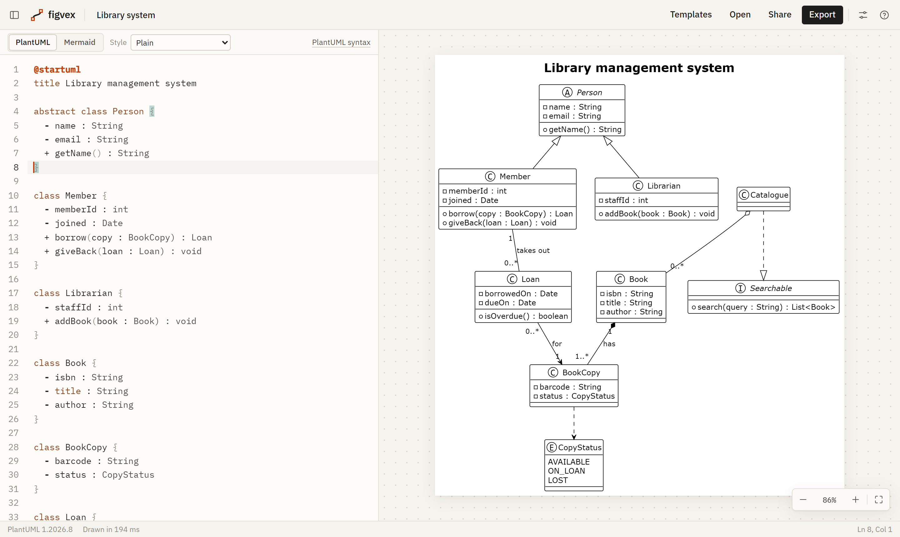
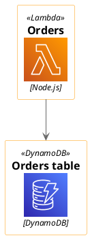
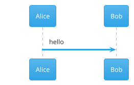

# Figvex

[](https://app.netlify.com/projects/figvex/deploys)

**Live site: [figvex.sudo520.com](https://figvex.sudo520.com)**

A live editor for PlantUML, Mermaid, Graphviz and BPMN diagrams, network diagrams, org charts, data charts and freeform sketches. Type on the left, the diagram redraws on the right. It runs in the browser, and your diagrams stay on your machine unless you share them or turn on the PlantUML server option.

It was built for computer science students: UML for software engineering courses, ER diagrams for databases, state machines and automata for theory, trees and graphs for algorithms, Gantt charts for group projects, and charts of results for lab reports.



## Features

- Live preview for PlantUML, Mermaid, Graphviz DOT, BPMN 2.0 and ECharts data charts, with box plots, histograms, trend lines and density curves worked out from raw data, with the language picked up from the first line
- ER diagrams drawn straight from SQL: paste `CREATE TABLE` statements, or a whole PostgreSQL, MySQL, SQLite or SQL Server dump, and get tables with crow's foot links
- Boolean logic: truth tables, Karnaugh maps with their groups, the simplest sum of products and product of sums, and gate circuits, from an expression or a list of minterms
- Automata: DFAs, NFAs with ε moves and Turing machines from their transitions, with each input run through the machine and a step-through on the diagram
- Digital timing diagrams, register bit fields and logic from assignments, with WaveDrom
- Data structure pictures: arrays with pointers, stacks, queues, linked lists, trees, binary search trees, heaps, hash tables and graphs, one per line
- Cloud diagrams with the official AWS, Azure, Google Cloud and Kubernetes icons, and a search that inserts any of 1,200 icons with its includes
- UI wireframes: phone, tablet and browser screens of common controls, with arrows for the user flow, drawn clean or sketchy
- Network diagrams with device icons, subnets, VLANs, ports and link types, and checks that catch address mistakes as you type
- Org charts from an indented list of people, with departments, assistants, vacancies, dotted lines and three card styles
- A sketch canvas for freeform diagrams: boxes, arrows that stay attached, text and pen, in a clean or hand-drawn style
- 114 templates written around coursework: a library system class diagram, JWT login sequence, TCP state machine, DFA for multiples of 3, binary search tree, hash table, confusion matrix, sorting benchmark, library loan process, login wireframe, an app sign-in flow, society committee org chart, subnetting exercise, university ER schema from SQL, levelled data flow diagrams, Karnaugh maps, a full adder circuit, Turing machines, an SPI timing diagram, hash tables with chaining and probing, capstone Gantt plan, communication, composite structure and interaction overview diagrams and more
- Export to SVG, PNG, JPG, WEBP and vector PDF, at 1× to 4× scale, with a solid or transparent background
- Copy the image straight to the clipboard for pasting into a report or slides
- Share links that carry the whole diagram in the URL, with no server involved
- Copy as a Markdown code block, or as a plantuml.com image link for a README
- Plain black-and-white PlantUML by default, with PlantUML's own colours and its 40 bundled themes one click away
- Click a shape in the diagram to jump to the line that drew it; rename, add and remove from the diagram for org charts and networks, rename for Graphviz and Mermaid flowcharts, and drag BPMN shapes
- Errors point at the line, with a marker in the editor; PlantUML class, sequence and state diagrams are also checked for common modelling mistakes
- Every diagram saved in the browser, with rename, duplicate, delete and undo; collapsed, the list stays as a narrow rail of recent diagrams
- A language picker above the editor that you can type into to search; changing the language of a diagram with real content starts a new one, so nothing is overwritten
- Open `.puml`, `.mmd`, `.gv`, `.dot`, `.bpmn`, `.sketch`, `.org`, `.network`, `.sql`, `.logic`, `.automaton`, `.wavedrom`, `.structures`, `.wireframe`, chart and Markdown files, or drag them onto the window; a `.csv` file opens as a bar chart of its columns
- Light and dark themes for the app and for the diagrams, separately
- Pan and zoom with mouse, trackpad or touch; works on phones as two tabs

## How it works

PlantUML runs through [`@plantuml/core`](https://www.npmjs.com/package/@plantuml/core), the official build of PlantUML compiled to JavaScript with TeaVM. It is built from the same source as the Java release and carries the same version number. Graphviz layouts come from Viz.js. It needs neither Java nor a server.

Mermaid runs through the [`mermaid`](https://www.npmjs.com/package/mermaid) package and is only downloaded the first time you open a Mermaid diagram.

Graphviz DOT uses the same Viz.js file that PlantUML loads, so it adds nothing to the download. A DOT diagram on its own loads only that file, not the rest of PlantUML.

Charts use [Apache ECharts](https://echarts.apache.org/), downloaded the first time you open one (about 280 KB compressed). Only the chart types listed below are bundled.

The app itself is TypeScript, Vite and CodeMirror 6, with no UI framework.

### What reaches the network

- The page and its scripts, from wherever you host it.
- PlantUML standard library bundles (C4, AWS icons and so on) when a diagram uses `!include <...>`. Bundles with a permissive licence (C4, ArchiMate, DomainStory) are served from your own site. The rest come from `plantuml.github.io` unless you change `VITE_PLANTUML_STDLIB_URL`; see [LICENSES.md](LICENSES.md#plantuml-standard-library).
- On the live site only, Google Analytics page views, and only if you allow them. A banner asks on your first visit, and you can change the answer under Settings → Privacy. Until you allow it, the Google tag isn't loaded and no cookies are set. The page address is sent without the part after `#`, where share links keep the diagram, so diagram contents aren't sent. Other builds leave it out.
- Nothing else, unless you turn on the PlantUML server option (below) or copy a plantuml.com image link.

## Supported diagrams

| PlantUML | Mermaid | Graphviz |
| --- | --- | --- |
| Sequence, use case, class, object, activity, component, deployment, state, timing | Flowchart, sequence, class, state, ER, user journey | Directed and undirected graphs, written in DOT |
| ER (crow's foot), JSON, YAML | Gantt, pie, quadrant, XY chart, Sankey | Trees, automata, dependency graphs, record-based data structures |
| Gantt, mind map, work breakdown | Git graph, mind map, timeline, Kanban | All Graphviz layouts: `dot`, `neato`, `fdp`, `sfdp`, `circo`, `twopi`, `osage`, `patchwork` |
| Regex, EBNF, ArchiMate, C4 and the rest of the standard library | Packet, block, architecture, C4, requirement, radar, treemap and the newer types in Mermaid 12 | |

PlantUML's `@startdot` blocks are drawn with Graphviz too.

The browser build of PlantUML doesn't include these yet: Salt wireframes, ditaa, math and LaTeX, nwdiag, Chen ER, `@startfiles`, `@startchronology`, `@startboard`, `@startgit`, `@startwire`, `@starthcl`, and `!include` from a URL.

When a diagram uses one of these, Figvex says so instead of showing a stack trace. In Settings you can turn on **Use server for missing types**. Only those diagrams are then sent to a PlantUML server to be drawn. The default is plantuml.com; you can point it at your own server (see Docker below).

### Modelling checks

PlantUML draws a class, sequence or state diagram even when the model has a mistake in it. Figvex checks for the common ones and marks them in the editor margin and the status bar, without stopping the drawing:

- **Class diagrams:** inheritance that goes round in a circle, impossible multiplicities such as `5..2` or `1...*`, a class declared twice, an attribute in an interface, and a name in a relationship that looks like a typo of a declared class (PlantUML would quietly add a second class)
- **Sequence diagrams:** a message to a name that looks like a typo of a declared participant, an activation that's never closed, and a deactivation with nothing active
- **State diagrams:** states that can't be reached from the start

The templates also show three UML diagrams PlantUML has no keyword for, drawn the way textbooks draw them: communication, composite structure and interaction overview diagrams.

## Editing from the diagram

You can change a diagram without touching the text. Every change is written into the text, so undo, saving and sharing work as for typing.

| Language | In the diagram |
| --- | --- |
| BPMN | Drag shapes (see [BPMN](#bpmn)) |
| Sketch | Draw, move, resize and connect shapes (see [Sketches](#sketches)) |
| Org chart | Rename a person, add a report under them, or remove them (their team moves up to their manager) |
| Network | Rename a device, zone or link; add a device linked to the selected one, in the same zone; remove a device with its links, or a single link |
| Graphviz | Rename a node (sets its `label`) |
| Mermaid flowchart | Rename a node (the text in its brackets) |

Click an item to select it. A small bar above it has the actions. Double-click, Enter or F2 renames it, Insert adds, and Delete removes. A click also shows the item's line in the editor, as before.

## BPMN

Business process diagrams in BPMN 2.0 are drawn by Figvex's own renderer, written from the OMG specification. There's no bpmn.io watermark, because bpmn-js isn't used.

- Files from Camunda Modeler, bpmn.io, Signavio and other tools open as they are, drawn with the positions saved in the file.
- Files with no saved positions are laid out automatically: left to right, with pools and lanes as horizontal bands. A short process can be written by hand:

```xml
<definitions xmlns="http://www.omg.org/spec/BPMN/20100524/MODEL">
  <process id="p">
    <startEvent id="start" name="Order received" />
    <userTask id="pack" name="Pack order" />
    <endEvent id="end" name="Shipped" />
    <sequenceFlow id="f1" sourceRef="start" targetRef="pack" />
    <sequenceFlow id="f2" sourceRef="pack" targetRef="end" />
  </process>
</definitions>
```

Shapes can be dragged in the diagram. The new positions are written into the XML when you let go, so undo, saving and sharing work as for typed changes.

- Shapes snap into line with their neighbours, or move in steps of 5. Hold Alt to move freely.
- Arrow keys nudge the selected shape by 1, or by 10 with Shift. Ctrl+Z and Ctrl+Y undo and redo from the diagram.
- Flows attached to a moved shape follow it with right-angled routes. Boundary events move with their activity.
- A pool is dragged by its name band and takes everything in it along. A task dropped in another lane is moved into that lane in the XML.
- The first drag in a file with no saved positions adds them, so the layout you make is kept.
- A click without a drag still selects the element's line in the editor.

Supported: start, end, intermediate and boundary events with message, timer, error, signal, escalation, conditional, link, compensation, cancel and terminate markers; tasks of every type; sub-processes, transactions and call activities; loop and multi-instance markers; all five gateway types; data objects and data stores; pools, lanes, message flows, text annotations and groups. Colours set with bpmn.io's `bioc:` or the OMG `color:` attributes are kept. Typing `<` in the editor lists the BPMN elements.

## Sketches

For diagrams that don't fit a language: draw them. Pick **Blank sketch** under Templates, then use the tools above the diagram.

| Tool | Key | |
| --- | --- | --- |
| Select | V | Click to select, Shift-click to add, drag on empty space to box-select, drag to move, drag a corner to resize |
| Box, Ellipse, Diamond | R, O, D | Drag to draw, or click for the usual size |
| Arrow, Line | A, L | Start or end on a shape to attach to it; attached lines follow when it moves |
| Connector | C | An arrow with right angles, for org charts and flow diagrams |
| Text | T | Click and type |
| Pen | P | Freehand |

Double-click a shape or arrow (or press Enter) to edit its label; double-click empty space to add text. Delete removes the selection, Ctrl/⌘ D duplicates it, arrow keys nudge it, and Ctrl/⌘ Z undoes. Shapes snap to a 10 px grid; hold Alt to place freely. Scroll, or hold Space and drag, to pan.

Snapping and arranging:

- While moving, resizing or drawing, a shape lines up with the edges and centres of the shapes around it, and a guide line shows what it lined up with.
- While drawing or re-attaching a line, the shape under the pointer shows a connection point on each side. Drop on one to pin the line to that side (`ceo.bottom`); drop anywhere else on the shape and the side follows the shape's position.
- E switches the selected lines between straight and right angles.
- With two or more shapes selected, buttons appear to align their left edges, centres, right edges, tops, middles or bottoms; with three or more, to space them evenly across or down.

A sketch is stored as text, one element per line, so it saves, shares and undoes like everything else, and you can edit it on either side:

```
sketch
box login 40 40 160 80 "Login page" round fill=#fde68a
ellipse user 260 60 120 60 "User"
arrow user -> login "signs in" dashed
line login.right -> user.left elbow dashed
text note 40 160 "Notes go here" size=18
```

Elements are `box`, `ellipse`, `diamond`, `text`, `arrow`, `line` and `pen`. Options are `fill=`, `stroke=`, `width=`, `size=`, `dashed`, `round` and `bold`; arrows and lines also take `both` or `none` for their heads and `elbow` for right angles, and either end can name a side, such as `ceo.bottom`. The Style menu switches between **Clean** and **Hand-drawn**.

## Org charts

Write the people as an indented list and Figvex lays out the chart. Indenting a line puts that person under the line above.

```
orgchart
title "Northwind Software"
counts
Jane Smith: Chief Executive [Executive]
  + Lee Park: Executive Assistant
  Ravi Patel: Chief Technology Officer [Engineering]
    Ana Lopez #ana: Engineering Manager
      Tom Reed: Developer
      ?: Graduate Developer
  Mia Chen #mia: Chief Financial Officer [Finance]
ana .. mia "budget"
```

| Write | For |
| --- | --- |
| `Name: Job title [Department]` | A person. Only the name is needed. People without a department take their manager's colour. |
| `+ Name: Job title` | An assistant, shown beside the manager rather than below |
| `?: Job title` | A vacant post, drawn dashed |
| `Name #id` | A short name, for dotted lines or when two people share a name |
| `a .. b "label"` | A dotted-line (matrix) reporting line |
| `title "…"` | A heading above the chart |
| `direction right` | Left to right instead of top down |
| `compact` | Stack the bottom level of each branch in a column, for wide teams |
| `counts` | Show how many people sit under each manager |

The Style menu has **Cards** (initials and a department colour strip), **Minimal** (black and white, for printing) and **Bold** (department-coloured headers). Department colours come with a legend, and clicking a person jumps to their line. For a chart you want to arrange by hand instead, use a sketch with the Connector tool.

## UI wireframes

Screens of common controls, one per line and indented under their screen, with arrows between screens for a user flow.

```
wireframe
screen login "Sign in" phone
  header "Campus app"
  field "Email" "you@uni.ac.uk"
  password "Password"
  row
    checkbox "Remember me" on
    link "Forgot password?"
  button "Sign in" primary
screen home "Home" phone
  header "Today" menu
  list "Timetable" "Grades" "Library"
  nav *"Home" "Search" "Profile"
login -> home "Sign in"
```

A screen is `phone`, `tablet`, `desktop`, `browser` or `window`, or a size like `400x600`; it grows to fit what's in it. Quoted text is what a control shows, and words after it change it.

| Control | Writes | Options |
| --- | --- | --- |
| `header "Title"` | An app bar | `back`, `menu` |
| `nav "A" *"B" "C"`, `tabs` | A navigation bar or tabs; `*` marks the current one | |
| `heading`, `text`, `link` | Text; `text` wraps | |
| `field "Label" "placeholder"`, `password`, `textarea`, `search`, `dropdown "Label" "Value"` | Inputs | `filled` shows the text as typed |
| `checkbox`, `radio`, `toggle` | Choices | `on` |
| `slider "Label" 40`, `progress "Label" 70` | A slider or progress bar at a percentage | |
| `button "OK"` | A button | `primary`, `danger`, `small` |
| `image "Caption" 160`, `avatar "Name" "detail"` | Placeholders | a height for images |
| `list "One" "Two"` | A list with chevrons | |
| `table "Name" "Email"` | A table; indented `row "Ann" "ann@uni.ac.uk"` lines are its rows | |
| `alert "Saved"` | A message box | `info`, `success`, `warning`, `error` |
| `row`, `card "Title"`, `box` | Containers: `row` puts the controls indented under it side by side | `dashed` for a box |
| `divider`, `space 24` | Spacing | |

`a -> b "label"` draws an arrow from screen a to screen b. The Style menu picks **Clean** or **Sketchy**, which draws everything by hand like a paper prototype. Clicking a control jumps to its line.

## Cloud diagrams

PlantUML's standard library has the official AWS, Azure, Google Cloud and Kubernetes icon sets. Each icon is a macro, `Name(alias, "label", "technology")`, after two includes: the library's common file and the icon's own.



**Icons** above the editor (PlantUML only) searches all of them by name, shows a preview, and inserts the icon at the cursor along with any includes the diagram doesn't have yet. The templates include an AWS three-tier web app, an AWS serverless API, an Azure web app, a Google Cloud data pipeline and a Kubernetes deployment. The icons load from the official PlantUML host the first time a diagram uses them.

## Networks

Write devices, zones and links, and Figvex lays out the network with device icons. Indenting devices under a `zone` line puts them in it. A zone can be a subnet, a VLAN or a whole site, and zones can sit inside each other.

```
network
title "Small office"
internet
firewall fw "Firewall" 203.0.113.2/30
zone dmz "DMZ" 172.16.0.0/24 vlan 30
  server web "Web server" 172.16.0.10
zone office "Office" 10.10.0.0/16
  switch core "Core switch" 10.10.0.2
  zone staff "Staff" 10.10.10.0/24 vlan 10
    pc desks "Desk PCs" x12
    printer prn "Printer" 10.10.10.5
internet -- fw "WAN"
fw:eth1 -- web
fw:eth2 == core:ge0/1 "trunk" vlan 10, 20
core -- desks, prn
```

| Write | For |
| --- | --- |
| `type name "Label" addresses` | A device. Types: `internet`, `cloud`, `router`, `firewall`, `switch`, `lb`, `ap`, `server`, `vm`, `database`, `storage`, `pc`, `laptop`, `phone`, `printer`, `camera`, `iot`, `user` |
| `"Note"`, `vlan 20`, `x12` | After a device: a second line of text, its access VLAN, or a count drawn as a stack |
| `zone name "Label" 10.0.0.0/24 vlan 10` | A zone. The subnet and VLAN are optional; a zone with neither is drawn dashed, as a site |
| `a -- b` | A cable. `==` is a trunk or fibre link, `..` a VPN or tunnel, `~~` wireless |
| `a -- b, c, d` | Several links from one device |
| `a:ge0/1 -- b:eth0` | Port names at either end |
| `"label" vlan 10, 20` | After a link: a label and the VLANs it carries |
| `title "…"` | A heading above the diagram |
| `direction right` | Left to right instead of top down |
| `lines curved` | `straight` (default), `curved` around devices, or `square` for right-angled lines |
| `checks off` | Turn off the address checks |
| `# comment` | A comment |

Addresses can be IPv4 or IPv6, with or without a prefix. Figvex checks them as you type and marks anything that looks wrong in the editor margin, on the device and in the status bar. Clicking the warning count goes to the first one. It checks for:

- an address outside its zone's subnet
- the same address on two devices
- a subnet's network or broadcast address used by a device
- a zone subnet with host bits set, such as `10.0.0.5/24`
- zone subnets that overlap, or a zone's subnet outside the zone around it
- the same VLAN on two zones at one site, or a device on a different VLAN from its zone
- devices that aren't linked to anything

The checks don't stop the drawing. The Style menu has **Colour tiles**, **Outline** and **Greyscale**. Clicking a device, link or zone jumps to its line.

## ER diagrams from SQL

Paste SQL and Figvex draws the tables, their keys and the foreign keys between them. It reads `CREATE TABLE`, `ALTER TABLE ... ADD`, `CREATE UNIQUE INDEX` and `COMMENT ON`, and skips everything else, so a full `pg_dump` or `mysqldump` file works as it is. PostgreSQL, MySQL, SQLite and SQL Server syntax are all understood, including quoted, backticked and bracketed names.

```sql
-- title: Shop
-- group: Sales
CREATE TABLE customers (
  id serial PRIMARY KEY,
  email varchar(255) NOT NULL UNIQUE
);
CREATE TABLE orders (
  id serial PRIMARY KEY,
  customer_id int NOT NULL REFERENCES customers (id),
  gift_for int REFERENCES customers (id)
);
```

Each foreign key becomes a link from its column to the column it refers to, with crow's foot ends:

- On the referenced side, two bars mean every row has a parent. A bar and a circle mean the foreign key can be NULL.
- On the other side, the crow's foot means many rows can point at one parent. When the foreign key is also unique or the primary key, it becomes a bar and a circle: zero or one.

Rows are marked **PK**, **FK** or **UQ**. A `?` after the type means the column allows NULL.

| Comment | Does |
| --- | --- |
| `-- title: Shop` | A heading above the diagram |
| `-- group: Billing` | Puts the tables after it in a box, until the next `-- group:`. An empty `-- group:` ends it. Tables in two or more schemas are boxed by schema when there are no groups |
| `-- focus: orders, customers` | Draws only these tables and the tables they link to |

These are plain SQL comments, so the script still runs.

Figvex marks problems in the editor margin and on the table without stopping the drawing: a foreign key to a table or column that isn't defined, a table defined twice, a table with no primary key, and an `ALTER TABLE` for a table that doesn't exist. The Style menu has **Colour**, **Black and white** and **Keys only**, which hides every column that isn't a key. Clicking a table, column or link jumps to its line.

## Logic

Write a boolean expression and Figvex draws its truth table, its Karnaugh map with the groups circled, the simplest form and, if you ask, the gate circuit.

```
logic
title "Full adder"
vars A B Cin
S = A ^ B ^ Cin
Cout = AB + Cin(A ^ B)
G(A, B, C, D) = m(0, 2, 5, 7, 8, 10, 13, 15) + d(1, 9)
show table kmap simplified circuit
```

Operators can be written the way your course writes them:

| Operator | Write |
| --- | --- |
| NOT | `!A`, `~A`, `¬A`, `not A` or `A'` |
| AND | `A·B`, `A.B`, `A*B`, `A&B`, `A∧B`, `A and B`, or side by side: `AB` |
| OR | `A+B`, `A\|B`, `A∨B`, `A or B` |
| XOR, XNOR | `A^B`, `A⊕B`, `A xor B`; `A⊙B`, `A xnor B` |
| NAND, NOR | `A↑B`, `A nand B`; `A↓B`, `A nor B` |

NOT binds tightest, then AND, XOR and OR. A variable is a letter, optionally followed by digits (`A`, `x1`), so `AB` is A AND B. Longer names such as `Cin` work once they are listed on a `vars` line.

| Line | Does |
| --- | --- |
| `F = expression` | A function. Its variables are the ones it uses, in alphabetical order |
| `F(A, B, C) = m(1, 3, 5) + d(7)` | A function from its minterms, with optional don't cares. `M(...)` lists maxterms instead |
| `vars A B C` | The variables and their order, for the table and the maps |
| `show table kmap simplified circuit minterms` | What to draw (or `all`). The default is table, map and simplified |
| `form sop` / `pos` / `both` | Simplify to a sum of products, a product of sums, or both |
| `circuit written` / `simplified` | Draw the circuit as written or from the simplest form |
| `gates ansi` / `iec` | Curved gate shapes, or IEC boxes with `&` and `≥1` |
| `compare F G` | Checks two functions give the same output for every input, or lists where they differ |
| `title "…"`, `# comment` | A heading, and a comment |

Simplification uses the Quine–McCluskey method, so the answer is minimal, and don't cares are used only where they help. Karnaugh maps are drawn for 2 to 4 variables and truth tables for up to 6, and each group on the map has the same colour as its term in the answer. The Style menu picks the notation for the answers: **Overbars** (Ā·B), **Primes** (A'B), **Logic symbols** (¬A ∧ B) or **Programming** (!A && B).

## Automata

Write the transitions and Figvex draws the state diagram, runs each input through it, and lets you step through a run on the diagram.

```
automaton
title "Strings that end in ab"
start q0
accept q2
q0 -b-> q0
q0 -a-> q1
q1 -a-> q1
q1 -b-> q2
q2 -a-> q1
q2 -b-> q0
input abab
```

| Line | Does |
| --- | --- |
| `q0 -a-> q1` | A transition. `q0 -a, b-> q1` takes either symbol, and `q0 -> q1 : a` is the same thing |
| `q0 -ε-> q1` | A move that reads nothing (also `eps`) |
| `q0 -1/0,R-> q1` | A Turing machine move: read 1, write 0, move right (`L`, `R` or `S` to stay). Separate several with `;` |
| `start q0` | The start state. Without it, the first state written is the start |
| `accept q2 q3` | Accepting states, drawn with a double ring |
| `input abba` | A string to run. `input ε` is the empty string. Symbols longer than a character are separated by spaces: `input coin push` |
| `states q0 q1 q2` | The order states are first placed in, if it matters |
| `blank _`, `direction down`, `title "…"`, `# comment` | The Turing machine blank, a top-down layout, a heading, a comment |

Figvex works out what kind of machine it is: a Turing machine when the moves are read/write,direction; a DFA when every state has at most one move per symbol and there are no ε moves; otherwise an NFA, which is run as a set of states at once. Under the diagram, each input shows whether it is accepted and why. Turing machines stop after 500 steps if they don't halt.

The bar at the bottom of the diagram steps through a run: the current states and the arrows just followed are highlighted, and the tape shows where the head is. The menu in the bar picks which input to follow. Figvex warns about states that can't be reached, a machine with no accepting state and inputs that use a symbol no transition reads.

## Timing diagrams

Timing diagrams are drawn by [WaveDrom](https://wavedrom.com/) from WaveJSON, which Figvex picks up when the text starts with `{ signal: [...] }`, `{ reg: [...] }` or `{ assign: [...] }`.

```
{ signal: [
  { name: 'clk',  wave: 'p.......' },
  { name: 'data', wave: 'x.345x..', data: ['A0', 'A1', 'A2'] },
  { name: 'ack',  wave: '0..1.0..' }
] }
```

Each character in a `wave` is one clock cycle: `p` and `n` are clocks, `0` and `1` levels, `x` unknown, `z` high impedance, `.` the same as before, and `=`, `2` to `9` bus values labelled from `data`. `node` and `edge` draw arrows between points, square brackets group signals, and `head` and `config` set a title, tick numbers and the horizontal scale. `reg` draws register bit fields and `assign` draws gates from nested expressions. The [WaveDrom tutorial](https://wavedrom.com/tutorial.html) covers the rest.

The Style menu picks WaveDrom's **default**, **narrow** or **low-key** skin; dark diagrams use its dark skin. WaveDrom is loaded the first time a timing diagram is drawn.

## Data structures

One structure per line, drawn the way textbooks draw them.

```
structures
array A = [7, 2, 9, 4, 1, 8] mark 2, 3 ptr lo=0 mid=2 hi=5
stack S = [10, 20, 30]
queue Q = [a, b, c, d]
list L = 3 -> 1 -> 4
bst B = 50 30 70 20 40 60 80
heap H = [90, 70, 80, 30, 50]
hash T size 7 = 10, 22, 31, 4, 15
graph G = A-B:4, A-C:2, B-C:5
```

| Line | Draws |
| --- | --- |
| `array A = [1, 2, 3]` | Cells with their indexes |
| `matrix M = [[1, 0], [0, 1]]` | A grid with row and column numbers |
| `stack S = [1, 2, 3]` | A stack with the last item on top |
| `queue Q = [a, b, c]` | A queue with its front and rear |
| `list L = 1 -> 2 -> 3` | A linked list ending in null; `<->` for doubly linked, `circular` to link the last node back to the first |
| `tree T = 8(3(1, 6), 10(, 14))` | Any tree, as value(children). An empty slot (`10(, 14)`) keeps a lone child on the right |
| `bst B = 8 3 10 1 6` | The binary search tree you get by inserting the values in order |
| `heap H = [9, 5, 8, 1]` | A heap as a tree and as its array |
| `hash H size 7 = 10, 22, 31` | A hash table with separate chaining; `probe linear` or `probe quadratic` for open addressing |
| `graph G = A-B, B-C:4` | An undirected graph, with optional weights; `digraph` and `->` for a directed one |

After any structure, `mark 2, 3` highlights items (by index in arrays and heaps, by value elsewhere), and `ptr i=0 j=4` puts named pointers under array cells. Hash tables hash a number by itself and text by the sum of its character codes, mod the size. Figvex warns when a heap isn't a heap, a pointer is past the end of its array, or a probing table runs out of room.

## Charts

A chart is an [ECharts option](https://echarts.apache.org/en/option.html) written as JSON. Comments and trailing commas are allowed. Data can go in the JSON, or as CSV under a line of three dashes, where it becomes the chart's dataset:

```
{
  "title": { "text": "Students per language" },
  "xAxis": { "type": "category" },
  "yAxis": {},
  "series": [{ "type": "bar" }]
}
---
language,students
Python,120
Java,85
C,40
```

Each column after the first becomes a series, in order. `"width"` and `"height"` at the top level set the size in pixels (720 × 440 by default).

Chart types: bar, line, pie, scatter, radar, box plot, heatmap, candlestick, funnel, gauge, Sankey, graph, tree, treemap, sunburst, parallel coordinates and theme river. JSON can't hold functions, so options that need a JavaScript callback, such as a custom tooltip formatter, aren't available; string templates like `"{b}: {c}"` work.

### Statistics from raw data

Four transforms work out statistics from raw rows, so the CSV can hold the data as it was collected. Put the data first in `"dataset"`, then the transform; series draw the result with `"datasetIndex"` or `"datasetId"`:

```
"dataset": [{}, { "transform": { "type": "stat:histogram", "config": { "dimension": "minutes", "width": 5 } } }],
"series": [{ "type": "bar", "datasetIndex": 1 }]
```

| Transform | Config | Makes |
| --- | --- | --- |
| `stat:histogram` | `dimension`; `width` or `bins` (Sturges' rule if neither); `start` | Columns bin, count, percent, density, from, to |
| `stat:boxplot` | `group` and `value` for long data, or `dimensions` for one column per group; `whiskers`: `tukey` (default) or `minmax` | Columns group, low, q1, median, q3, high, n, and a second dataset `<id>-outliers` |
| `stat:regression` | `x`, `y`, `method` (linear, polynomial with `order`, exponential, logarithmic, power), `points` | Points along the fitted line |
| `stat:density` | `dimension`, `bandwidth` (Silverman's rule by default), `points` | A Gaussian kernel density curve: columns x, density |

Quartiles use linear interpolation between data points, as Excel's `QUARTILE.INC` and R's default do. In any text, `{equation}` and `{r2}` show the fitted equation and R² of the trend line that series draws, or of the first trend line elsewhere. The chart templates include a box plot, a histogram, a trend line and a density curve built this way.

## Styles

PlantUML diagrams are drawn with the `plain` theme by default: black lines, white boxes, no fills. That suits printed reports.

The **Style** menu above the editor switches to PlantUML's classic colours or any of its bundled themes. The style is applied while drawing and doesn't change your source. To keep a look when the file is used elsewhere, put the theme in the diagram:



A `!theme` line in the diagram always wins over the menu. Mermaid has the same menu, with its own themes.

For Graphviz the menu has two choices. **Plain** draws labels in a sans-serif font, and **Graphviz defaults** keeps Times, as the `dot` command does. Colours, fonts and shapes set in the DOT source always win.

For charts it sets the colour palette: ECharts' **Default**, **Colour-blind safe** (Okabe and Ito's palette) or **Greyscale** for black-and-white printing. A `"color"` list in the chart wins.

## Run it locally

Needs Node 20 or later.

```sh
npm install
npm run dev
```

Then open http://localhost:5173.

`npm install` copies the PlantUML engine from `node_modules` into `public/vendor/`. If that folder is ever missing, run `node scripts/copy-plantuml.mjs`.

### Tests

```sh
npm test            # unit tests (Vitest)
npm run build
npm run test:e2e    # browser tests against the production build
```

The browser tests drive Chrome with puppeteer-core. They render every template, check error reporting, click-to-source and the SVG, PNG and PDF exports. They look for Chrome in the usual places; set `CHROME_PATH` if yours is elsewhere. Without Chrome they're skipped.

## Deploy to Netlify

Releases go `dev` to `staging` to `main`. `staging` is deployed as a Netlify branch deploy for testing; `main` is the live site. See [CONTRIBUTING.md](CONTRIBUTING.md#branches-and-releases) for the commands.

1. Push the repository to GitHub, GitLab or Bitbucket.
2. In Netlify, choose **Add new project → Import an existing project** and pick the repository.
3. Leave the build settings alone. `netlify.toml` sets the build command (`npm run build`), the publish folder (`dist`), Node 22 and the cache headers.
4. Under **Project configuration → Developer settings → Continuous deployment → Branches and deploy contexts**, set the production branch to `main`, and under branch deploys choose **Let me add individual branches** and add `staging`.

The build downloads the permissively licensed PlantUML stdlib bundles from `plantuml.github.io` so the site can serve them itself. If that download fails, the build still succeeds and those bundles are fetched from `plantuml.github.io` at runtime instead.

On the free plan, each production deploy costs 15 credits out of a 300-credit limit, so deploy releases rather than every commit. Netlify's Open Source plan raises the limit; see [Hosting costs](ROADMAP.md#hosting-costs-on-netlify) in the roadmap.

Any static host works the same way: run `npm run build` and serve `dist/`.

## Docker

```sh
docker compose up -d
```

Figvex is then on http://localhost:8080. The image is a two-stage build: Node builds the site, nginx serves it.

To keep everything on your own machines, including the diagram types the browser engine lacks, run a PlantUML server next to it:

```sh
VITE_PLANTUML_SERVER=http://localhost:8081 docker compose --profile server up -d --build
```

The server address is baked in at build time, so it has to be reachable from your users' browsers, not only from the container.

Without Compose:

```sh
docker build -t figvex .
docker run -p 8080:8080 figvex
```

## Configuration

Set these as environment variables when building (in Netlify under **Site configuration → Environment variables**, or as Docker build arguments).

| Variable | Default | Purpose |
| --- | --- | --- |
| `VITE_REPO_URL` | `https://github.com/ahmed-imraan-ai/figvex` | GitHub links in the header, the help menu and the About box. Set it to an empty string to hide them |
| `VITE_SITE_URL` | Netlify's `URL`, else `https://figvex.netlify.app` | Public address used for the canonical link, social preview cards, `robots.txt` and `sitemap.xml` |
| `VITE_GA_ID` | none | Google Analytics ID (`G-...`). Used only in Netlify production builds, and loaded only after the visitor allows it; `netlify.toml` sets the live site's |
| `VITE_PLANTUML_SERVER` | `https://www.plantuml.com/plantuml` | Server for diagram types the browser engine lacks, and for copied image links |
| `VITE_PLANTUML_STDLIB_URL` | `https://plantuml.github.io/plantuml/js-plantuml/` | Where stdlib bundles not shipped with the site come from |
| `PLANTUML_STDLIB_SOURCE` | same as above | Where `scripts/fetch-stdlib.mjs` downloads bundles from during the build |

## Project layout

```
src/
  main.ts             wiring: documents, rendering, toolbar, shortcuts
  engines/            PlantUML, Mermaid, Graphviz, ECharts, BPMN, sketch, org chart, network, SQL, logic, automaton, WaveDrom, data structure and wireframe engines, language detection, themes
  editor/             CodeMirror setup, syntax colouring, autocomplete
  preview.ts          pan and zoom canvas, click-to-source
  export.ts           SVG, PNG, JPG, WEBP and PDF export
  share.ts            share links
  store.ts            diagrams and settings in localStorage
  analytics.ts        Google Analytics, loaded only after the visitor allows it
  templates/          the template gallery
  ui/                 popovers, dialogs, library drawer
scripts/              engine copy and stdlib download, run at install and build
tests/unit/           Vitest unit tests
tests/e2e/            browser tests
docker/               nginx config for the Docker image
```

## Keyboard shortcuts

| Keys | Action |
| --- | --- |
| Ctrl/⌘ K | Templates |
| Ctrl/⌘ B | Expand or collapse your diagrams |
| Ctrl/⌘ O | Open a file |
| Ctrl/⌘ S | Download the source file |
| Ctrl/⌘ Shift E | Export image |
| Ctrl/⌘ Enter | Redraw now |
| Ctrl/⌘ / | Comment or uncomment lines |
| 0 and 1 on the diagram | Fit to view, actual size |
| Enter or F2 on the diagram | Rename the selected item |
| Insert, Delete on the diagram | Add under or remove the selected item (org charts, networks) |
| Arrow keys on a BPMN diagram | Nudge the selected shape (Shift: 10) |
| ? or F1 | Help |

## Roadmap

The full plan is in [ROADMAP.md](ROADMAP.md). It has three phases:

1. Complex networking and visual editing (done).
2. Statistical charts, UI wireframes, network diagrams, advanced UML, cloud infrastructure, complex data models and coursework tools (both done: ER diagrams from SQL, logic, automata, timing diagrams and data structures).
3. Advanced scientific and financial charts, geographic maps, CAD, 3D, electrical schematics, formal process models and interactive visual analytics.

AI assistance is planned alongside these, through MCP only: people use their own assistant and subscription, such as Claude Code or Claude Desktop, and it works with Figvex through a local `figvex-mcp` server. There's no login; links and pairing codes connect the assistant to the user's diagrams. Figvex runs no AI service of its own.

Ideas and pull requests are welcome. See [CONTRIBUTING.md](CONTRIBUTING.md) and the [Code of Conduct](CODE_OF_CONDUCT.md).

## AI use

AI was used in this project.

## Licence

Figvex is MIT licensed. See [LICENSE](LICENSE).

[LICENSES.md](LICENSES.md) covers everything Figvex ships or loads: the licence of each component, how the PlantUML standard library is handled, which services are contacted, and why the project uses MIT rather than GPL. Each build also writes `third-party-licenses.txt` with the full licence text of all 158 bundled packages; the deployed site links to it from the Help dialog.
